<p align="center">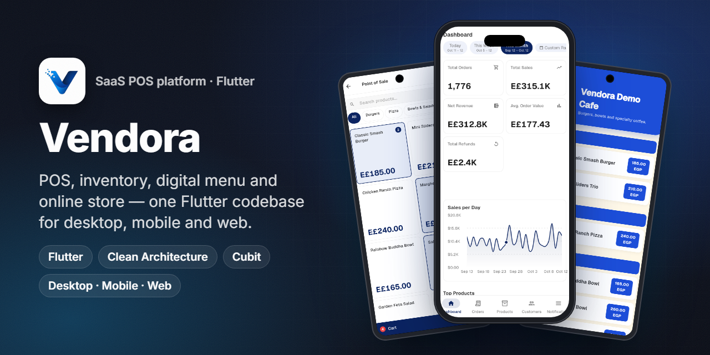</p>
<h1 align="center">Vendora</h1>
<p align="center"><b>A multi-tenant POS and commerce platform built in Flutter. Point of sale, inventory, digital QR menu and online store come from one codebase that runs on desktop, mobile and web.</b></p>
<p align="center">
  
  
  
  
  
  
  
  
</p>

## Overview

Vendora is a SaaS for shops, cafés and restaurants. A vendor signs up, picks a plan, and runs the business from one app:

- a **keyboard-first POS** on the counter PC,
- **inventory** across branches and warehouses,
- **purchasing**, **reports** and **staff permissions**,
- a public **QR digital menu** and **online storefront** built from the same catalog.

A **super-admin portal** manages vendors, plans, billing and subscriptions.

This repository contains the **Flutter client**. The UI switches layout by screen width: at ≥ 1024 px it shows a desktop shell with a sidebar, and below that a mobile shell with a bottom navigation bar. Both use the same Cubits, use cases and repositories. The app talks to a REST backend through Dio, and uses Firebase for push notifications, analytics, error reporting and the public menu (Firestore and Storage).

**My role:** product owner and lead Flutter engineer. I did the architecture, design system, every feature module, localization and the web, desktop and mobile builds.

| | |
|---|---|
| Codebase | ~123k lines of Dart · 29 feature modules · 100 pages · 45 Cubits · 68 routes |
| Platforms | Windows desktop, Android, iOS, Web (single codebase, width-adaptive) |
| Languages | English, Arabic (RTL), German, French, Italian |

## The challenge

- **One product, three form factors.** A cashier needs a dense desktop POS with hotkeys and barcode scanning. An owner needs a phone app. Diners need a link they can open without logging in. All three must share one catalog and one order stream.
- **Multi-branch stock.** A sale has to decrement the right warehouse. Stock also moves through transfers, counts, adjustments and goods receipts, and each movement must be auditable.
- **White-label per vendor.** Every vendor brings its own colors, logo, menu design and storefront theme.
- **Arabic-first market.** The app needs full RTL, Arabic numerals and dates, and EGP/SAR currency formatting, without losing the LTR layouts.

## Highlights

**🧾 Sales**
- Desktop POS: branch and warehouse session setup, category tabs (F1–F5), barcode-scanner input, line and order discounts, undo (Ctrl+Z), cash, card or transfer payment with change calculation, PDF receipts with auto-print, sound feedback.
- Mobile POS with a cart bottom sheet that uses the same `PosCubit` / `CartCubit`.
- Orders from POS, online and menu channels. Supports refunds, fulfillment status and public order tracking (`/track/:token`).
- Reservations, with a public booking page (`/book/:slug`), schedules, time slots and closed dates.

**📦 Inventory and purchasing**
- Stock by warehouse, stock movements and FIFO cost layers.
- Warehouses, transfers (approve, post, receive), stock counts and adjustments.
- Suppliers, supplier ledger, aging report and goods receipts.

**📊 Insights**
- Dashboard: KPIs, 30-day sales chart, top products and top customers, with date-range filters.
- Financial reports (P&L, sales, inventory valuation, FIFO profit) and inventory reports, exported to **Excel** and **PDF**.

**🌐 Online presence**
- **Digital QR menu** with 8 designs, a live preview, QR code, PDF export and a public URL `/menu/:slug`.
- **Online storefront** with 12 themes in light and dark, cart, checkout and order tracking. Still in progress, see the roadmap.
- Homepage builder for the storefront layout.

**🔐 Platform**
- Roles and permissions, users, branches, device security (log out or block devices) and an activity log.
- Push notifications (FCM), analytics and remote error reporting.
- Super-admin portal: vendors, plans, billing, subscriptions, finance and analytics.

## Screens

> Screens come from the real Flutter **web build** of this repo, run locally against a small mock API with **fictional demo data**. The menu photos are from Unsplash.

<p align="center">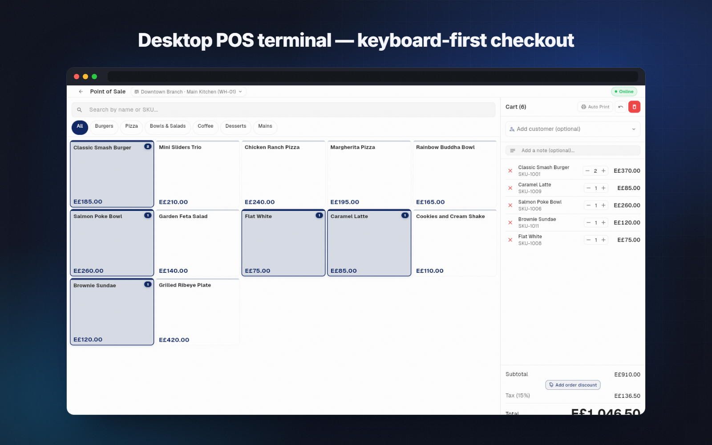</p>
<p align="center">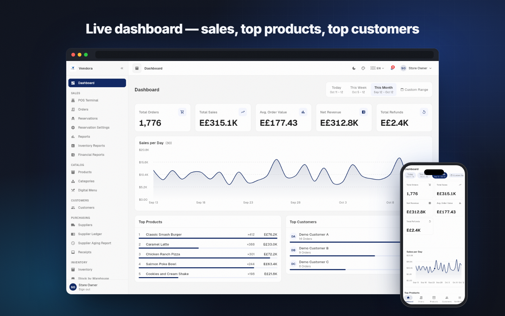</p>
<p align="center">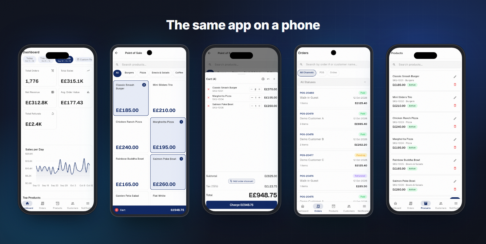</p>

<table>
  <tr>
    <td>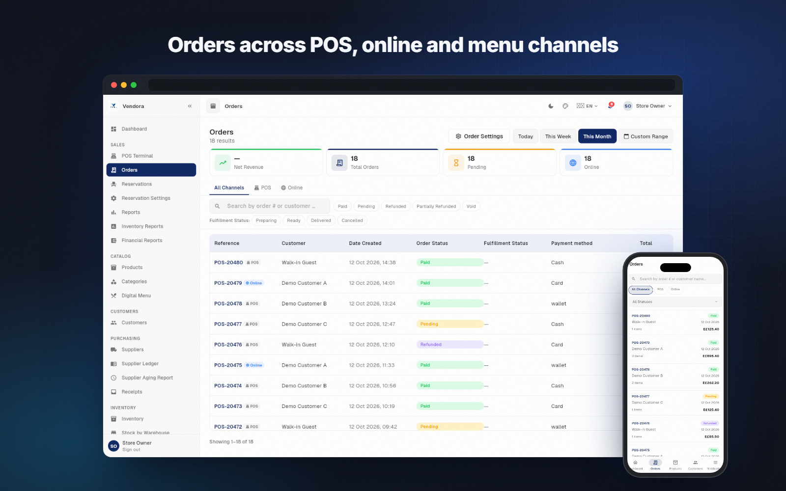</td>
    <td>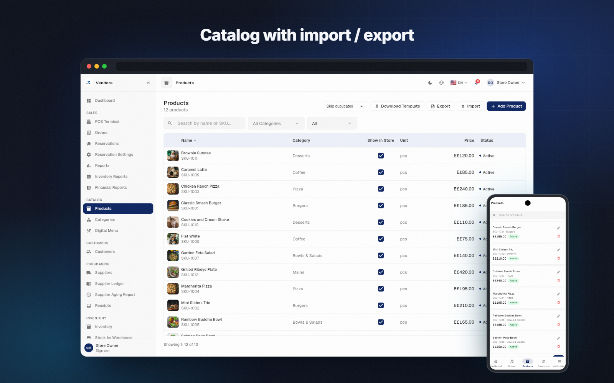</td>
  </tr>
  <tr>
    <td align="center">Orders across channels</td>
    <td align="center">Catalog with import / export</td>
  </tr>
  <tr>
    <td>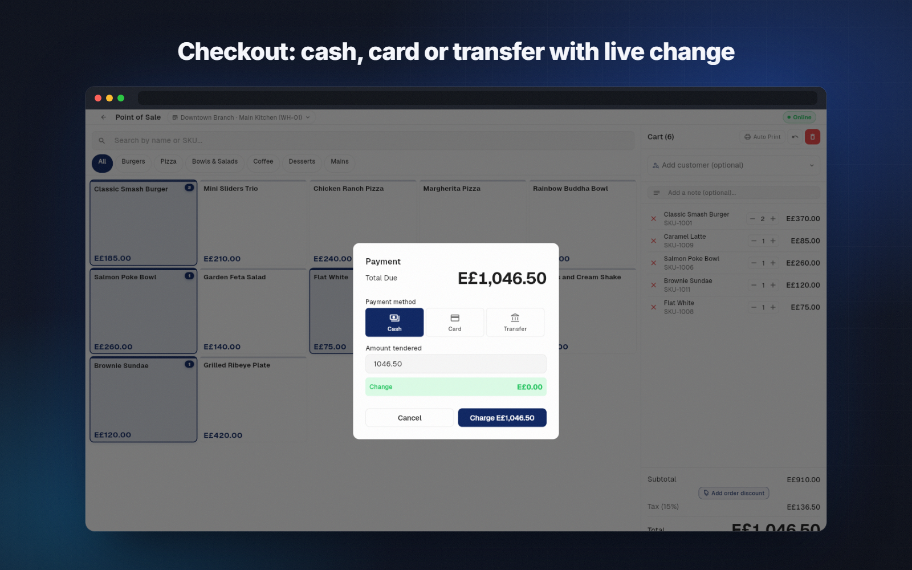</td>
    <td>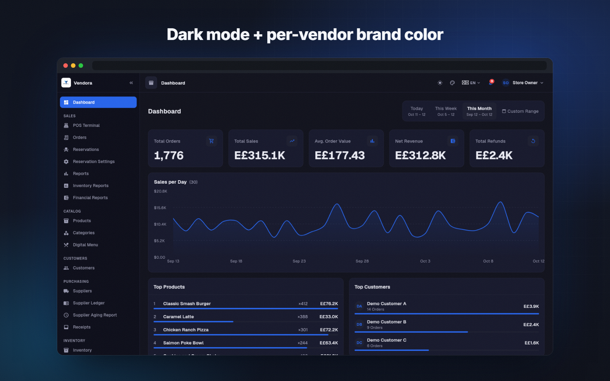</td>
  </tr>
  <tr>
    <td align="center">Checkout and change</td>
    <td align="center">Dark mode + vendor brand color</td>
  </tr>
  <tr>
    <td>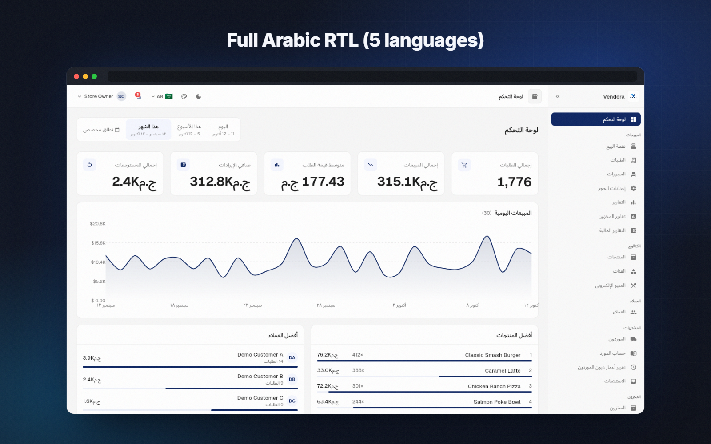</td>
    <td>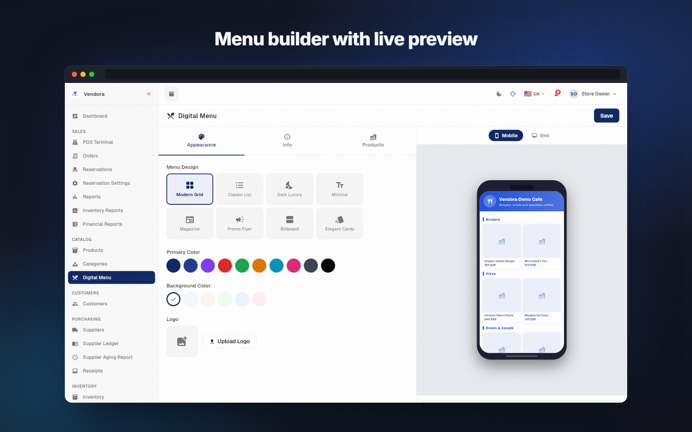</td>
  </tr>
  <tr>
    <td align="center">Full Arabic RTL</td>
    <td align="center">Digital-menu builder with live preview</td>
  </tr>
</table>

## Signature feature: the QR digital menu

<p align="center">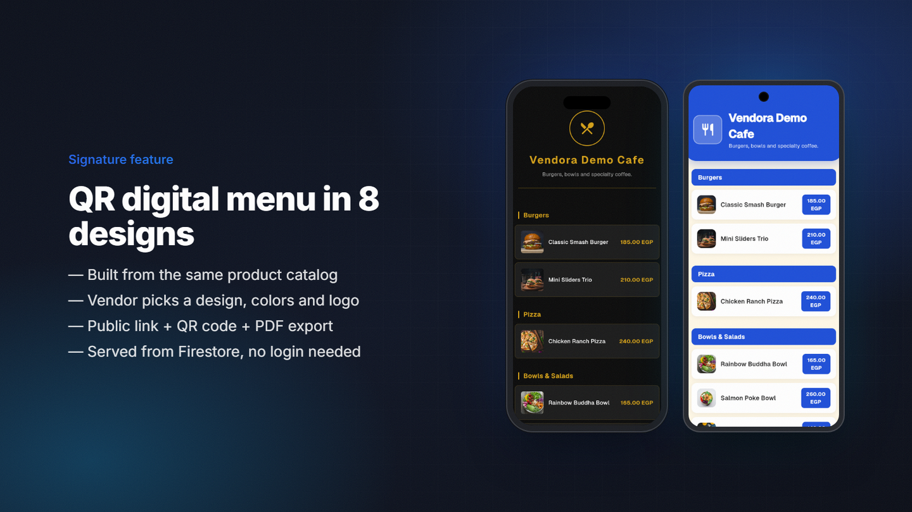</p>

The vendor opens **Digital Menu**, picks one of 8 designs (Modern Grid, Classic List, Dark Luxury, Minimal, Magazine, Promo Flyer, Billboard, Elegant Cards), then sets a primary and background color and uploads a logo. Products, prices and visibility come straight from the catalog. A menu-only price can override the POS price. On save:

1. The settings and per-product configuration are written to **Cloud Firestore** under `menus/{vendorId}`. A `slugIndex/{slug}` document maps the public slug to the vendor. The logo goes to **Firebase Storage**.
2. The public route `/menu/:slug` skips the auth guard. It resolves the slug, loads the menu and renders the chosen theme. A diner only needs a phone browser.
3. The builder generates a **QR code** (`qr_flutter`) and a printable **PDF** (`pdf` / `printing`) for the tables.

<p align="center">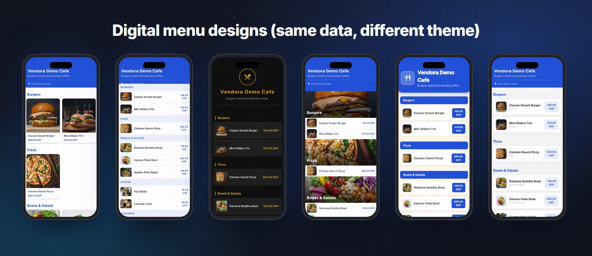</p>

## Architecture & stack

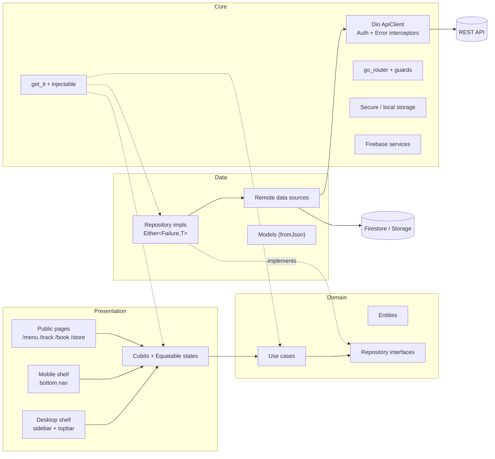

| Layer | Tech |
|---|---|
| UI | Flutter (Material 3), custom design system, `fl_chart`, `data_table_2`, `shimmer`, `responsive_framework` |
| State | `flutter_bloc` **Cubits** with `equatable` states |
| Navigation | `go_router` with auth and admin redirects, width-based desktop/mobile builders, public routes |
| DI | `get_it` + `injectable` (generated config) |
| Domain | Use cases per operation, entities, repository interfaces, `dartz` `Either<Failure, T>` |
| Network | `dio` with auth (Bearer) and error interceptors (errors reported to Firestore), `connectivity_plus` |
| Storage | `flutter_secure_storage` (token), `shared_preferences` (theme, locale, cache) |
| Firebase | `firebase_messaging`, `firebase_analytics`, `cloud_firestore`, `firebase_storage`, local notifications |
| Documents | `pdf`, `printing`, `excel`, `qr_flutter`, `file_picker` (web and native file savers) |
| i18n | `intl` + JSON dictionaries (`assets/i18n/*.json`, ~1,700 keys each), RTL |

### Project structure

```
lib/
├── core/
│   ├── api/            # ApiClient (Dio), ApiEndpoints, ApiResponse, interceptors
│   ├── cubit/          # ThemeCubit (mode + brand color), LocaleCubit
│   ├── di/             # get_it + injectable setup
│   ├── error/          # Exceptions → Failures
│   ├── firebase/       # analytics, FCM notifications, error reporter
│   ├── l10n/           # AppLocalizations (JSON-backed)
│   ├── router/         # go_router config, guards, route names
│   ├── storage/        # secure + local storage
│   └── utils/          # formatters, extensions, enums, file savers (web/native)
├── design_system/
│   ├── theme/          # colors, presets, text styles, spacing, radius, shadows, durations
│   └── widgets/        # buttons, inputs, cards, tables, dialogs, feedback, charts, badges…
├── layouts/            # desktop shell, mobile shell, admin shell, nav items
├── features/           # 29 modules, each data/ domain/ presentation/
│   ├── pos/  orders/  reservations/  public_booking/
│   ├── products/  categories/  digital_menu/  storefront/  homepage_builder/
│   ├── inventory/  warehouses/  transfers/  stock_counts/  adjustments/  receipts/
│   ├── customers/  suppliers/  reports/  dashboard/
│   ├── branches/  users/  roles/  devices/  settings/  store_settings/
│   ├── notifications/  activity_log/  auth/  admin/
├── firebase_options.dart   # placeholder, values via --dart-define
└── main.dart
```

### State management

Every screen is driven by a **Cubit** whose states extend `Equatable`. Typical states are `Initial`, `Loading`, `Loaded(data)` and `Error(message)`. Cubits call **use cases** only. Use cases call **repository interfaces**, and those return `Either<Failure, T>`, so the UI never sees an exception. A few examples:

- `AuthCubit` restores the session from secure storage, falls back to a cached user when offline, and feeds `go_router`'s redirect.
- `PosCubit` owns the session: branch and warehouse, catalog, search, category filter, order submission and auto-print. `CartCubit` owns the cart: lines, discounts, customer, note and an undo history.
- `ThemeCubit` / `LocaleCubit` persist the theme mode, brand color preset and language, and rebuild `MaterialApp.router`.

### Design system

All UI is built from `lib/design_system`:

- **Tokens:** colors (light/dark, semantic, status, chart), 8 brand color presets, the Geist type scale, a 4-pt spacing scale, radii, shadows and durations.
- **Widgets:** `AppButton`, `AppTextField`, `AppSelectField`, `AppSearchField`, `AppDateRangePicker`, `StatCard`, `AppDataTable` + `AppPagination`, `AppDialog`, `StatusBadge`, `SalesAreaChart`, shimmer loaders, empty and error states, snackbars, avatars and breadcrumbs.

## Engineering notes

- **One codebase, two layouts.** Routes pick a desktop or mobile page with `MediaQuery` width (`>= 1024`). Desktop and mobile pages share the same Cubit instance and data layer, so a fix in a use case reaches both.
- **Keyboard-first POS.** A `HardwareKeyboard` handler buffers fast key bursts to tell a **barcode scanner** apart from typing. It maps F1–F5 to categories, Enter to charge, D to discount, `/` to search and Ctrl+Z to undo the cart.
- **Printing and exports on every platform.** Receipts and reports are produced with `pdf` / `printing`, and spreadsheets with `excel`. A conditional-import `FileSaver` (web vs native) handles downloads in the browser and on desktop.
- **Public routes beside an authenticated app.** `/menu/:slug`, `/track/:token` and `/book/:slug` are whitelisted in the router's `redirect`. Diners and customers use them without an account, and the staff app stays guarded, including the admin-only `/admin/*`.
- **RTL and 5 languages.** Strings live in JSON dictionaries loaded by a custom `AppLocalizations`. Layouts use directional padding and alignment, so Arabic mirrors the whole app, charts and tables included.
- **Resilient sessions.** The auth interceptor attaches the Bearer token. The error interceptor maps 401/402/403/5xx to typed failures. On network errors, `AuthCubit` restores the cached user instead of logging out.

## Platforms

| Platform | Status | Notes |
|---|---|---|
| Windows (desktop) | ✅ | Primary target for the counter POS, keyboard and scanner |
| Web | ✅ | Admin app and public menu, booking and tracking pages. Firebase Hosting config included |
| Android | ✅ | Mobile layout |
| iOS | ✅ | Mobile layout (needs your own `GoogleService-Info.plist`) |

## Getting started

**Requirements:** Flutter 3.22+ (Dart ≥ 3.4) and a running Vendora-compatible REST API. Firebase is optional for local UI work, but push notifications, analytics and the digital menu need it.

```bash
git clone https://github.com/ANaSHaker/vendora.git
cd vendora
flutter pub get

cp .env.example .env          # fill in API_BASE_URL and Firebase values
flutter run -d chrome  --dart-define-from-file=.env
flutter run -d windows --dart-define-from-file=.env
```

If you change `@injectable` annotations, regenerate the DI config:

```bash
dart run build_runner build --delete-conflicting-outputs
```

## Configuration

All configuration is passed at build time with `--dart-define` (see [`.env.example`](.env.example)). The repo contains no keys.

| Variable | Purpose |
|---|---|
| `API_BASE_URL` | Base URL of the REST backend (default `http://localhost:8000`) |
| `APP_BASE_URL` | Public URL of the web build, used for shareable menu and booking links |
| `FIREBASE_*` | Firebase web/Android/iOS/Windows options read by `lib/firebase_options.dart` |
| `FCM_VAPID_KEY` | Web push key for Firebase Cloud Messaging |

**Firebase setup.** Create a Firebase project, then either fill the `FIREBASE_*` values or run `flutterfire configure` to regenerate `lib/firebase_options.dart` locally. If you regenerate it, don't commit it. Then:

- Android: add `android/app/google-services.json`. iOS: add `ios/Runner/GoogleService-Info.plist`. Both are git-ignored.
- Web push: put your web config in `web/firebase-messaging-sw.js` (it ships with placeholders).
- Firestore collections used by the menu: `menus/{vendorId}` (+ `products` subcollection) and `slugIndex/{slug}`.

## Roadmap

- [ ] Storefront: replace the remaining mock data in `features/storefront` with the live storefront API
- [ ] Offline-first POS queue (local persistence + sync)
- [ ] Unit and widget tests for Cubits and use cases (`bloc_test` / `mocktail` are already set up)
- [ ] Biometric unlock on mobile
- [ ] macOS and Linux desktop targets
- [ ] Clean up the remaining `flutter analyze` infos (const constructors, deprecated APIs). There are no errors.

## Contributing

Issues and PRs are welcome. Please keep to the existing structure: one feature per folder with `data/domain/presentation`, Cubits only, use cases for business logic, and design-system widgets instead of ad-hoc styling. Run `flutter analyze` before opening a PR.

## License

[MIT](LICENSE) © 2026 Mahmoud Shaker

## بالعربي

**Vendora** منصة SaaS لإدارة المحلات والكافيهات والمطاعم، مبنية بالكامل بـ Flutter من كود واحد يشتغل على الديسكتوب والموبايل والويب.
فيها نقطة بيع سريعة بالكيبورد وقارئ الباركود، وإدارة مخزون متعدد الفروع والمخازن، ومشتريات وموردين، وتقارير مالية بتصدير Excel وPDF.
فيها كمان منيو رقمي بـ QR بـ 8 تصميمات ومتجر أونلاين بنفس المنتجات، وبوابة سوبر أدمن للباقات والاشتراكات.
المعمارية Clean Architecture مع Cubit و`Either<Failure, T>` وget_it/injectable وgo_router، ومعاها نظام تصميم كامل ووضع داكن ولون لكل تاجر.
التطبيق بيدعم 5 لغات منها العربي بالكامل من اليمين لليسار.

## Links

- Source: this repository
- More work: [github.com/ANaSHaker](https://github.com/ANaSHaker)

---
<h3 align="center">Built by Mahmoud Shaker — Senior Flutter Engineer</h3>
<p align="center">
  <a href="https://wa.me/201140279111"></a>
  <a href="https://www.linkedin.com/in/anashaker/"></a>
  <a href="https://anashaker.github.io/shaker_portfolio/"></a>
  <a href="mailto:mahmoudshaker382001@gmail.com"></a>
  <a href="https://khamsat.com/user/sheko201566"></a>
  <a href="https://mostaql.com/u/ShekoShaker"></a>
  <a href="https://github.com/ANaSHaker"></a>
</p>
